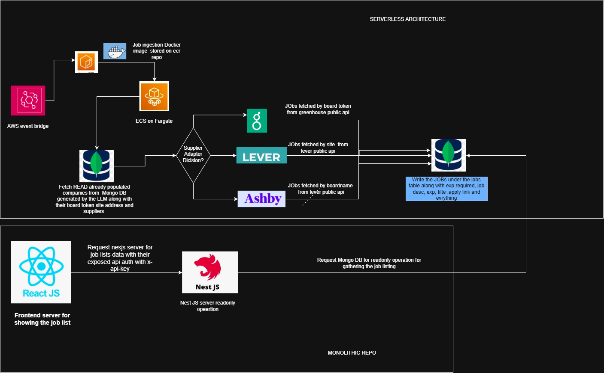
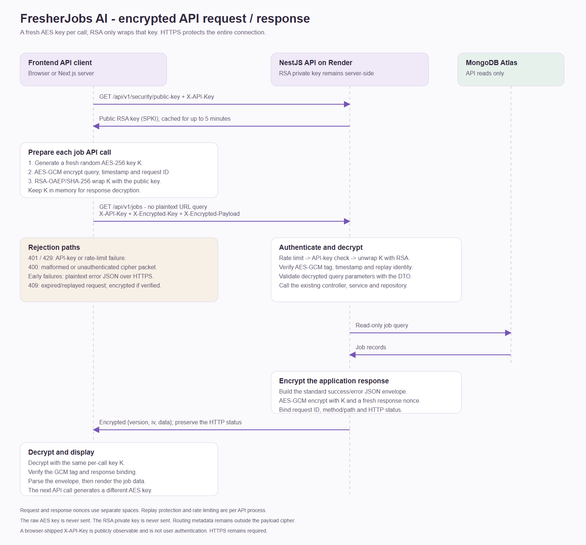

# FresherJobs AI - Project Beep

An India-focused job discovery platform for freshers and internship seekers. Public recruitment-board adapters collect real postings, MongoDB Atlas stores normalized jobs, a read-only NestJS API serves them, and a Next.js frontend provides search and job details.

**[Live website](https://fresher-job-search.vercel.app)** · **[Browse jobs](https://fresher-job-search.vercel.app/jobs)** · **[API readiness](https://beep-api-zjav.onrender.com/api/v1/health/ready)** · **[Repository](https://github.com/addycracker/fresher-job-search)**

> **Status - 20 November 2026:** The Vercel frontend and Render API have been verified end to end. The evaluation snapshot contains **391 jobs**, including **257 India-location candidates**; these are not all verified fresher vacancies. **LLM role/city classification is not enabled**, so tagging accuracy is unmeasured. The AWS schedule described below is configured according to the project author; its first scheduled execution remains unverified.

## Contents

- [System architecture](#system-architecture)
- [Implementation and data flow](#implementation-and-data-flow)
- [Local development](#local-development)
- [API and security](#api-and-security)
- [Environment variables](#environment-variables)
- [Deployment](#deployment)
- [AWS ingestion configuration](#aws-ingestion-configuration)
- [50-post evaluation](#50-post-evaluation)
- [Cost per 1,000 posts](#cost-per-1000-posts)
- [Engineering findings and limitations](#engineering-findings-and-limitations)

## System architecture



The image above is the project author's architecture diagram, exported from draw.io. It shows scheduled ATS ingestion and the frontend/API read path. The implementation details below describe the fields actually stored, encryption, and verification status; the diagram is a high-level overview.

Two paths share MongoDB without coupling frontend traffic to job collection:

1. **Scheduled collection:** EventBridge Scheduler launches an ECS Fargate task. Amazon ECR supplies the Docker image, Secrets Manager supplies the database credential, and CloudWatch receives logs. Provider adapters fetch public postings and upsert jobs.
2. **User requests:** The Next.js application on Vercel calls the NestJS API on Render over HTTPS. The API validates/decrypts requests, makes bounded read-only MongoDB queries, and returns encrypted responses. The browser never connects directly to MongoDB.

## Technology stack

| Layer                      | Technology                                                              |
| -------------------------- | ----------------------------------------------------------------------- |
| Frontend                   | Next.js, React, TypeScript, Lucide icons                                |
| API                        | NestJS, Mongoose, class-validator, class-transformer, Swagger           |
| Database                   | MongoDB Atlas                                                           |
| Ingestion                  | TypeScript, Node.js, Docker, ECS Fargate                                |
| Source validation          | Zod and provider verification                                           |
| Sources                    | Greenhouse, Lever, Ashby public recruitment-board APIs                  |
| Frontend / API hosting     | Vercel / Render                                                         |
| AWS operations             | ECR, EventBridge Scheduler, CloudWatch Logs, Secrets Manager            |
| API protection             | HTTPS, RSA-OAEP, AES-256-GCM, API-key validation, Helmet, rate limiting |
| Optional company discovery | Google Gen AI / OpenAI SDKs; separate from job classification           |

## Implementation and data flow

### Company discovery and manual seeding

Companies use a stable, normalized website domain rather than their display name as identity. Recruitment sources are uniquely identified by `(provider, boardToken)` and linked to their company. Source board tokens are checked against public provider endpoints before persistence. Re-running the seed does not overwrite synchronization metadata.

Company discovery can request grounded candidates from a configured LLM provider, but candidates still pass shared validation, board verification and ownership checks. An LLM suggestion alone is never proof of a real recruitment board. **Company discovery is not a job-role/city classifier.**

### Ingestion

1. Read configured companies and job sources from MongoDB.
2. Select the provider adapter and fetch public job-board responses with bounded timeouts, pagination and retries.
3. Normalize title, company domain, source identity, application URL, location, employment type, descriptions and available posting dates.
4. Deduplicate within the run and upsert using the unique `(provider, boardToken, externalId)` identity. Existing rows are updated rather than duplicated on reruns. Cross-provider semantic duplicate detection is not implemented.
5. Use expiring per-source leases to prevent overlapping writers. Preserve the last successful synchronization metadata on failure, release leases and continue other sources where possible.
6. Emit structured completion/failure summaries and exit. The worker is a batch process, not an HTTP server.

The current worker stores public jobs without a strict India/fresher eligibility classifier. It does not infer missing experience, salary or city information, and it does not delete closed jobs automatically.

### Supported sources

| Provider   | Public endpoint pattern                                                     | Source identity  |
| ---------- | --------------------------------------------------------------------------- | ---------------- |
| Greenhouse | `https://boards-api.greenhouse.io/v1/boards/{boardToken}/jobs?content=true` | Board token      |
| Lever      | `https://api.lever.co/v0/postings/{boardToken}?mode=json`                   | Site/board token |
| Ashby      | `https://api.ashbyhq.com/posting-api/job-board/{boardToken}`                | Board name       |

Only actual, verified company/source records belong in `scripts/data/companies.json`. Public availability does not imply unlimited reuse: provider terms, request limits and source availability must be respected. The evaluation below verifies metadata availability, not a legal/terms compliance audit.

Provider references: [Greenhouse](https://docs.greenhouse.io/job-board), [Lever](https://github.com/lever/postings-api), [Ashby](https://developers.ashbyhq.com/docs/public-job-posting-api).

### Application reads

The existing `jobs`, `companies` and `jobsources` collections are reused. Listing queries use lean reads, public-field projections, bounded pagination and accurate matching counts. Company details are joined by domain in one batch query. Details include stored plain-text/HTML descriptions; HTML is sanitized before rendering. Missing provider fields remain missing rather than being fabricated.

## Repository layout

```text
apps/
  api/                   NestJS read-only API
  web/                   Next.js frontend and typed API client
  job-ingestion/         Public ATS adapters and Fargate worker
  company-discovery/     Grounded company/source discovery
packages/contracts/      Shared API and encrypted-transport contracts
src/                     Shared company/source schemas, validation and seeding
config/                  Required provider and runtime JSON configuration
scripts/                 Manual seeding, security setup and index preparation
scripts/data/companies.json
tests/                   Unit, HTTP and browser integration tests
docs/                    Architecture image and implementation guides
README.md                Project overview, 50-post audit and cost report
```

## Local development

Use **Node.js 22.15+ or 24** and npm. Run commands from the repository root.

```powershell
npm ci
```

For a fresh checkout, copy the environment examples **only if the destination files do not already exist**:

```powershell
Copy-Item .env.example .env.development
Copy-Item apps/web/.env.example apps/web/.env.local
```

Set the MongoDB connection string and allowed frontend origin. Then generate local security configuration once:

```powershell
npm run api:security:setup
```

This creates the ignored `.secrets/api-private.pem` file and matching API/browser client-key settings. It refuses to replace an existing security setup. Use a read-only MongoDB user for the API; ingestion and index preparation require separate write/index privileges.

Start the applications in separate terminals:

```powershell
npm run api:dev
```

```powershell
npm run web:dev
```

Open `http://localhost:3000`. Development Swagger is at `http://localhost:4000/api/docs`; it is disabled in production. The Swagger query UI does not construct encrypted headers automatically.

### Development and verification commands

| Command                                   | Purpose                                                         |
| ----------------------------------------- | --------------------------------------------------------------- |
| `npm run typecheck:all`                   | Type-check the shared code, API and frontend                    |
| `npm run lint`                            | Lint API, frontend and contracts                                |
| `npm test`                                | Run mocked unit/HTTP tests without production writes            |
| `npm run test:browser`                    | Read-only browser checks against running local applications     |
| `npm run build:all`                       | Build shared/worker code, API and frontend                      |
| `npm run api:build` / `npm run api:start` | Compile/start the production API                                |
| `npm run web:build` / `npm run web:start` | Build/start the production frontend                             |
| `npm run seed:companies -- --dry-run`     | Validate and verify seed records without MongoDB writes         |
| `npm run ingest:jobs -- --dry-run`        | Read sources and fetch postings without writes                  |
| `npm run api:indexes`                     | Explicit database-index provisioning; requires index privileges |

Real seeding and write-enabled ingestion modify MongoDB. Review the intended database, verified source dataset and write guards before running them. The API never creates indexes automatically. See the [ingestion guide](apps/job-ingestion/README.md) for write-mode safeguards.

## API and security

| Endpoint                          | Purpose                                               |
| --------------------------------- | ----------------------------------------------------- |
| `GET /api/v1/jobs`                | Search, filters, pagination and sorting               |
| `GET /api/v1/jobs/filters`        | Available filter options, capabilities and statistics |
| `GET /api/v1/jobs/:id`            | Public job details and sanitized description          |
| `GET /api/v1/security/public-key` | RSA public-key bootstrap; requires the client API key |
| `GET /api/v1/health`              | Liveness                                              |
| `GET /api/v1/health/ready`        | Readiness, including MongoDB connectivity             |

Listing parameters are `q`, `role`, `location`, `employmentType`, `workMode`, `page`, `pageSize` and `sort`. Employment groups are `internship`, `full-time`, `part-time` and `contract`. Only explicitly remote/virtual records support the remote filter. `role` searches job titles; it is not an AI category. `category` is rejected because classification is not stored.

Pages default to 12 records, with a maximum of 48. Sorting uses first-indexed time with a stable ID tie breaker. If an original posting date is unavailable, the UI labels the date **Indexed**. Search uses MongoDB text search when an appropriate index exists, otherwise a bounded escaped-word fallback. Provision the search indexes before serving substantial traffic.

Job API calls require `X-API-Key`, `X-Encrypted-Key` and `X-Encrypted-Payload`:



The diagram follows the implemented GET job API flow. The raw AES key is never transmitted; `X-Encrypted-Key` contains its RSA-wrapped form. `X-Encrypted-Payload` contains the encrypted query packet, and the backend returns an AES-GCM cipher envelope rather than plaintext job data.

1. The client generates a fresh AES-256-GCM key for each call.
2. RSA-OAEP/SHA-256 wraps that key with the server's public key.
3. The query payload is encrypted in headers. The backend unwraps and verifies it with its private key before normal request validation.
4. Responses use the same AES key with a fresh, separate response nonce and request/status binding. Application error envelopes after successful decryption are encrypted too.

HTTPS remains required. Bootstrap/probes and failures before an AES context is verified return plaintext JSON over HTTPS. The private RSA key stays on the backend. **A static browser API key is visible to visitors and identifies the public client; it is not user authentication.**

Helmet and explicit CORS are enabled. The default limit is **120 requests/IP/minute**, returning HTTP 429 with `Retry-After`. Rate limiting and replay protection are per process and reset on restart; distributed enforcement requires a shared/edge design. Arbitrary forwarded IP headers are not trusted by default.

## Environment variables

Local shell variables take precedence over `.env.development`, then `.env`. Next.js loads its own `apps/web/.env.local`. Production settings belong in the deployment dashboards/secret stores, not in Git.

| Variable                                         | Application / purpose                                            |
| ------------------------------------------------ | ---------------------------------------------------------------- |
| `API_MONGODB_URI`                                | API read-only database connection; falls back to `MONGODB_URI`   |
| `MONGODB_URI`                                    | Database connection for manual seeding and ingestion             |
| `API_PORT`                                       | API listening port; local default `4000`, Render setting `10000` |
| `API_CORS_ORIGINS`                               | Exact comma-separated frontend origins, without trailing slashes |
| `API_CLIENT_KEY`                                 | Value checked against the `X-API-Key` header                     |
| `API_PRIVATE_KEY_PATH`                           | Local PEM path, or Render secret-file path                       |
| `API_RATE_LIMIT` / `API_RATE_WINDOW_MS`          | Per-IP request limit and time window                             |
| `API_TRUST_PROXY`                                | Optional exact trusted proxy IPs/CIDRs                           |
| `API_SWAGGER_ENABLED`                            | Development Swagger flag; production always disables Swagger     |
| `NEXT_PUBLIC_API_BASE_URL`                       | Browser-facing API origin, set before building the frontend      |
| `API_BASE_URL`                                   | Server-side frontend API origin                                  |
| `NEXT_PUBLIC_API_KEY`                            | Public client identifier; must match `API_CLIENT_KEY`            |
| `WEB_SITE_URL`                                   | Canonical frontend origin for metadata                           |
| `DNS_SERVERS`                                    | Optional process-local DNS resolver IPs for Atlas SRV resolution |
| `INGESTION_ALLOW_WRITES`                         | Explicit ingestion write guard                                   |
| `INGESTION_TIMEOUT_MS` / `INGESTION_MAX_SOURCES` | Ingestion runtime bounds                                         |

Gemini/OpenAI credentials are only needed for optional company discovery. Job ingestion and the deployed frontend/API do not make job-classification LLM calls. Never publish MongoDB credentials, private keys or populated local environment files.

## Deployment

### Backend: Render

Use a Node Web Service with the repository root as its working directory:

| Setting      | Value                                                                      |
| ------------ | -------------------------------------------------------------------------- |
| Build        | `npm ci --include=dev && npm run api:build`                                |
| Start        | `npm run api:start`                                                        |
| Health check | `/api/v1/health/ready`                                                     |
| Environment  | `NODE_ENV=production`, `API_PORT=10000`, database/client-key/CORS settings |

The compiled entry point is `dist-api/apps/api/src/main.js`; the server binds to `0.0.0.0`. Upload `api-private.pem` through Render **Environment -> Secret Files**, then set `API_PRIVATE_KEY_PATH=/etc/secrets/api-private.pem`. Allow the API host through Atlas networking. Do not use the ingestion Dockerfile to deploy the web API.

### Frontend: Vercel

| Setting          | Value                              |
| ---------------- | ---------------------------------- |
| Framework        | Next.js                            |
| Root directory   | `apps/web`                         |
| Install          | `cd ../.. && npm ci --include=dev` |
| Build            | `npm run build`                    |
| Output directory | Next.js default                    |

Enable access to files outside the root directory so `packages/contracts` is included. Set both API base URLs to `https://beep-api-zjav.onrender.com`, set `WEB_SITE_URL=https://fresher-job-search.vercel.app`, and copy the matching client key to `NEXT_PUBLIC_API_KEY`. Render's CORS allowlist must include `https://fresher-job-search.vercel.app`. Redeploy the frontend after changing build-time `NEXT_PUBLIC_` settings. MongoDB credentials and the RSA private key belong only on the backend.

The live browser checks covered listings, encrypted request headers, CORS, pagination, filters, descriptions, mobile layouts and failure/retry states. This is separate from verification that a scheduled ingestion run actually executes each day.

## AWS ingestion configuration

The following configuration is supplied by the project author and is managed outside this repository in **Mumbai (`ap-south-1`)**:

| Resource             | Configuration                                                  |
| -------------------- | -------------------------------------------------------------- |
| ECR repository       | `beep-jobs-ingestion`                                          |
| ECS cluster          | `beep-cluster`                                                 |
| ECS task family      | `beep-ingestion`                                               |
| Container            | `job-ingestion`                                                |
| Task sizing          | 0.25 vCPU, 0.5 GiB memory                                      |
| Scheduler            | `beep-daily-ingestion`                                         |
| Schedule             | `cron(0 3 * * ? *)`, timezone `Asia/Kolkata` - daily 03:00 IST |
| CloudWatch log group | `/beep/ingestion`                                              |
| Database secret      | Injected through AWS Secrets Manager                           |

The project author reports a successful manual Fargate task run and creation of the schedule. **The first automatic scheduled invocation and its resulting freshness update have not been independently verified.** Source-level `lastSyncedAt` and CloudWatch task summaries should provide that evidence. No infrastructure is provisioned by the application or by this README.

## 50-post evaluation

**Report date: 20 November 2026.** The snapshot contained **391 stored jobs**, of which **257** matched explicit Indian location text. The company-stratified sample selected 50 unique posts across 14 companies, prioritizing early-career titles within each company. The sample is biased by those quotas and must not be used to estimate the proportion of eligible roles in the full database.

| Finding                                             | Result                | What it measures                                                  |
| --------------------------------------------------- | --------------------- | ----------------------------------------------------------------- |
| Sample still present on public ATS boards           | **50/50**             | Source availability at the check time                             |
| Stored titles match provider metadata               | **50/50**             | Source fidelity, not semantic tagging accuracy                    |
| Stored locations match provider metadata            | **50/50**             | Source fidelity, not city-classifier accuracy                     |
| Draft internship candidates                         | **16/50**             | Assistant review; human confirmation pending                      |
| Draft experienced roles                             | **31/50**             | Evidence does not meet strict zero-experience fresher eligibility |
| Draft unclear eligibility                           | **3/50**              | Insufficient evidence; not silently accepted as fresher roles     |
| Specific city resolvable from stored location       | **33/50**             | City coverage, not model accuracy                                 |
| Current internship filter matches draft internships | **4/16 (25% recall)** | Recall against draft references, not LLM accuracy                 |
| Human-confirmed reference labels                    | **0/50**              | An independent hand-check is still needed                         |
| Production LLM role/city predictions                | **0/50**              | No job-classification model has run                               |
| LLM role / city / joint accuracy                    | **N/A**               | Cannot be measured without predictions and confirmed references   |

The frozen MongoDB snapshot was captured at `2026-11-19T18:31:06.328Z` (20 November, IST). Source checks ran at `2026-11-19T18:38:10.351Z`, with **14 public ATS requests** and concurrency two. Both stored and current metadata were interpreted with the existing provider parser; this is an automated source-fidelity check, not an independent classification benchmark. The sampling seed was `fresherjobs-evaluation-2026-11-20`.

The review uses actual posting titles, locations and description evidence. Bangalore/Bengaluru variants map to **Bengaluru**. Country-only and Remote India locations remain **unspecified**; headquarters are never substituted for the posting's city. Internship eligibility is based on explicit internship evidence. Strict fresher eligibility means no mandatory professional experience; uncertain cases stay unclear.

**The labels below are assistant-generated review drafts. They are neither production LLM predictions nor a completed human audit.** Open each source, verify/correct the labels, and record the human reviewer and review date before claiming a hand-check. Do not turn the 50/50 metadata match into a claim of 100% tagging accuracy.

<details>
<summary><strong>View all 50 original posts, draft labels and review notes</strong></summary>

| #   | Original post                                                                                                                      | Company                | Stored location   | Draft role                 | Draft city  | Eligibility | Review note                                                                                                                                             |
| --- | ---------------------------------------------------------------------------------------------------------------------------------- | ---------------------- | ----------------- | -------------------------- | ----------- | ----------- | ------------------------------------------------------------------------------------------------------------------------------------------------------- |
| 1   | [Product Manager](https://jobs.ashbyhq.com/altimate/bafa3310-7dbd-4761-a9c9-4e21c6634547)                                          | altimate.ai            | Bengaluru         | product-management         | Bengaluru   | experienced | Minimum 7+ years in enterprise product management; not a fresher role.                                                                                  |
| 2   | [Senior Product Manager, Forward Deployed](https://jobs.ashbyhq.com/certifyos/a359c3ca-2937-427c-b9a3-f083c3bb04e6)                | certifyos.com          | Bengaluru, India  | product-management         | Bengaluru   | experienced | Requires 5+ years of product management or comparable founder ownership.                                                                                |
| 3   | [Product Ops Intern](https://jobs.ashbyhq.com/composio/cceb9883-7967-45a9-8e37-ed72cec3deff)                                       | composio.dev           | Bangalore         | product-operations         | Bengaluru   | internship  | Intern title and 2-month internship description; source employment type is FullTime.                                                                    |
| 4   | [Quality Assurance Engineering (QAE) - Intern](https://jobs.lever.co/drivetrain/edb8a8f7-16ac-4177-bf2e-99c36ab47d5f)              | drivetrain.ai          | India             | qa-testing                 | unspecified | internship  | QAE Intern with Internship employment type; India is a country, not a city.                                                                             |
| 5   | [Frontend Engineer - Internship](https://jobs.ashbyhq.com/certa/9f7caf0b-46ff-49ab-ae78-62deadec106e)                              | getcerta.com           | India             | frontend-engineering       | unspecified | internship  | Description explicitly specifies a paid 6-month internship; FullTime metadata conflicts; no city supplied.                                              |
| 6   | [Associate Software Development Engineer (SDE) Intern](https://jobs.lever.co/hevodata/993a3ed3-3014-432f-b0f4-28d300d58d9a)        | hevodata.com           | Bangalore, India  | software-engineering       | Bengaluru   | internship  | SDE Intern; description welcomes freshers with internship exposure; source labels it Full time.                                                         |
| 7   | [Intern, Talent Acquisition](https://jobs.ashbyhq.com/interview-kickstart/7653eff0-a253-4165-b4a4-17c2cd0cbfa2)                    | interviewkickstart.com | India             | people-recruiting          | unspecified | internship  | Talent Acquisition Intern; duties are recruitment support; only India is specified.                                                                     |
| 8   | [Enterprise Software Architect](https://jobs.ashbyhq.com/josys/ae1d9558-e25e-45cc-848a-3086e3243d45)                               | josys.com              | Bangalore Office  | software-architecture      | Bengaluru   | experienced | Requires 10+ years of engineering and 6 years of architecture experience.                                                                               |
| 9   | [Software Engineer(Intern)- Backend](https://jobs.lever.co/merklescience/e663b69b-264a-4bd7-b04d-fb3c0a824a28)                     | merklescience.com      | Bangalore         | backend-engineering        | Bengaluru   | internship  | Backend intern, one-year duration, with prior personal projects/internships desired.                                                                    |
| 10  | [Front End AI Engineer](https://jobs.ashbyhq.com/outmarket/80670027-3c1e-478c-ab2c-590be7194330)                                   | outmarket.ai           | Remote India      | frontend-engineering       | unspecified | experienced | Requires 2+ years of React frontend work; Remote India does not identify a city.                                                                        |
| 11  | [Marketing internship (brand & communication)](https://jobs.ashbyhq.com/sarvam/bba82f34-1544-421e-a393-3edd8a5f4cb2)               | sarvam.ai              | Bengaluru         | marketing                  | Bengaluru   | internship  | Marketing Intern described explicitly; FullTime source metadata obscures internship filtering.                                                          |
| 12  | [HR Intern](https://jobs.ashbyhq.com/span/1a44454a-c4eb-4a73-8f5b-7d3b921c0c1f)                                                    | span.io                | Bengaluru         | people-recruiting          | Bengaluru   | internship  | HR Intern with recruiting responsibilities; source employment type is FullTime.                                                                         |
| 13  | [Finance Intern - Remote](https://jobs.lever.co/Sprinto/78b7b003-6c37-4e49-a110-5f54d9e9bddf)                                      | sprinto.com            | Remote (India)    | finance                    | unspecified | internship  | Finance Intern title; stored employment type is Remote, which is a work arrangement; city unknown.                                                      |
| 14  | [SDR Intern](https://jobs.lever.co/weekdayworks/ed366116-2c23-48a9-9c8f-a6d46686ee67)                                              | weekday.works          | Bengaluru         | sales-business-development | Bengaluru   | internship  | SDR Intern, paid six-month internship; employment type missing; description says remote.                                                                |
| 15  | [Staff Software Engineer - India](https://jobs.ashbyhq.com/altimate/74b96721-bae8-4c07-83e2-f848079a071f)                          | altimate.ai            | Bengaluru         | backend-engineering        | Bengaluru   | experienced | Staff role requires 10+ years building Python backends.                                                                                                 |
| 16  | [Team Lead , Credentialing](https://jobs.ashbyhq.com/certifyos/3a92b968-7503-464d-9827-f446cfe89e4e)                               | certifyos.com          | Pune, India       | healthcare-operations      | Pune        | experienced | Team Lead requires credentialing/team experience; description contains conflicting 5+ and 1-2-year references; neither establishes fresher eligibility. |
| 17  | [Member of Technical Staff - Enterprise Platform](https://jobs.ashbyhq.com/composio/74cf1b48-86e9-4454-8c4e-cb2038ed0049)          | composio.dev           | Bangalore         | backend-engineering        | Bengaluru   | unclear     | Enterprise platform engineering responsibilities are clear; reviewed evidence does not establish zero-experience eligibility.                           |
| 18  | [Engineering Intern – Gen AI for FP&A Platform](https://jobs.lever.co/drivetrain/bc1c17bc-86ac-4f00-a1e3-0eb85aae4fdc)             | drivetrain.ai          | India             | data-ai-engineering        | unspecified | internship  | Engineering Intern focused on Gen AI; Internship metadata; India-only location.                                                                         |
| 19  | [AI Engineer](https://jobs.ashbyhq.com/certa/da4d5879-d94d-4f8c-ada4-24bd955520e3)                                                 | getcerta.com           | India             | data-ai-engineering        | unspecified | experienced | Requires 3+ years building production backend systems; no specific Indian city.                                                                         |
| 20  | [Associate Director - Technical Account Management (Pune)](https://jobs.lever.co/hevodata/a49edaa6-dd55-4e15-930e-ed0228169da2)    | hevodata.com           | Pune, Maharashtra | customer-success           | Pune        | experienced | Technical Account Management director role requires 10+ years overall and 5+ years leading teams.                                                       |
| 21  | [Program Advisor - US (AI Programs)](https://jobs.ashbyhq.com/interview-kickstart/17f887a4-412d-4819-93aa-4df6a83a7ce7)            | interviewkickstart.com | Remote - India    | sales-business-development | unspecified | unclear     | US Sales Program Advisor is based Remote India; US describes the sales market, not the work country; fresher eligibility is not established.            |
| 22  | [Senior Backend Engineer (Node.Js)](https://jobs.ashbyhq.com/josys/f6d35419-225f-42ca-a083-f433ebe15289)                           | josys.com              | Bangalore Office  | backend-engineering        | Bengaluru   | experienced | Senior Node.js role asks for 3-7 years; exceptional candidates may have approximately 2 years.                                                          |
| 23  | [Software Engineer - Intern (Frontend)](https://jobs.lever.co/merklescience/20675d00-156c-4f3f-a9bf-4cacee176bc2)                  | merklescience.com      | Bangalore         | frontend-engineering       | Bengaluru   | internship  | Frontend intern, one-year duration; stored Full-Time metadata conflicts with internship title and description.                                          |
| 24  | [IT Engineer](https://jobs.ashbyhq.com/outmarket/527e02fd-d54a-4440-9b6c-924e679dd825)                                             | outmarket.ai           | Remote India      | it-support                 | unspecified | experienced | Requires 3+ years of IT engineering/systems administration; Remote India has no city.                                                                   |
| 25  | [ML Engineer (Training Infra), Foundational Models](https://jobs.ashbyhq.com/sarvam/e9fb1269-fc4b-4879-aa35-0b75a8c83611)          | sarvam.ai              | Bengaluru         | data-ai-engineering        | Bengaluru   | experienced | ML training-infrastructure role requires 3+ years of relevant experience.                                                                               |
| 26  | [Platform Infrastructure Engineer](https://jobs.ashbyhq.com/span/618d8db2-903e-4f96-b7d6-567bce3877ed)                             | span.io                | Bengaluru         | platform-devops            | Bengaluru   | experienced | Description contains 8+ and 2+ experience references; both exclude a strict zero-experience fresher.                                                    |
| 27  | [Revenue & Operations Intern](https://jobs.lever.co/Sprinto/856517f8-cc53-4d48-a5aa-137734e61489)                                  | sprinto.com            | Bengaluru         | revenue-operations         | Bengaluru   | internship  | Revenue and Operations Intern; source employment type is Remote rather than internship.                                                                 |
| 28  | [Founder’s Office Intern](https://jobs.lever.co/weekdayworks/c7ef3e83-d2db-4170-a533-503751b4a0d5)                                 | weekday.works          | India             | business-operations        | unspecified | internship  | Founder Office description explicitly recruits interns; Full-time metadata conflicts; no specific city supplied.                                        |
| 29  | [Solution Architect](https://jobs.ashbyhq.com/altimate/4b91810a-5b64-43bc-9918-837a92db5206)                                       | altimate.ai            | Bengaluru         | solutions-engineering      | Bengaluru   | experienced | Solution Architect asks for 6+ years in customer-facing technical roles.                                                                                |
| 30  | [Director of Product Management, Applications](https://jobs.ashbyhq.com/certifyos/330bdd1f-1446-4348-9cc8-12b61d33c7bb)            | certifyos.com          | Bengaluru, India  | product-management         | Bengaluru   | experienced | Director role requires 10+ years of product management and 5+ years leading product teams.                                                              |
| 31  | [APM - integrations](https://jobs.ashbyhq.com/composio/64bda86f-f25f-42f3-9d1a-b6ad3d736ca2)                                       | composio.dev           | Bangalore         | product-operations         | Bengaluru   | experienced | APM integrations is ops-heavy and asks for 2-4 years; description explicitly says it is not internship-shaped.                                          |
| 32  | [Associate - Product Marketing](https://jobs.lever.co/drivetrain/e1d2e2b2-d9a5-40f6-b3c7-fbc75a715608)                             | drivetrain.ai          | India             | marketing                  | unspecified | experienced | Associate title still requires 1-4 years of marketing experience; no zero-experience eligibility established.                                           |
| 33  | [Software Development Engineer in Test - SDET](https://jobs.ashbyhq.com/certa/b11ff3f4-b175-426a-a05a-f1b687cd5eda)                | getcerta.com           | India             | qa-testing                 | unspecified | unclear     | SDET II owns test infrastructure and mentors junior engineers; reviewed excerpt lacks a definitive minimum-experience threshold.                        |
| 34  | [SDE- IV / Lead Engineer](https://jobs.lever.co/hevodata/c396cf1e-6a73-475d-b84b-aa90f916c8a2)                                     | hevodata.com           | Bangalore, India  | backend-engineering        | Bengaluru   | experienced | SDE IV / Lead Engineer requires 5-8 years building distributed systems.                                                                                 |
| 35  | [Software Engineer 2 , Machine Learning](https://jobs.ashbyhq.com/interview-kickstart/23e4b9c8-999a-41b2-91cf-caa63cf20888)        | interviewkickstart.com | India             | data-ai-engineering        | unspecified | experienced | ML Engineer 2 explicitly requires at least 2 years of full-time ML engineering experience.                                                              |
| 36  | [Senior Automation Engineer](https://jobs.ashbyhq.com/josys/336ee265-7efa-4d77-b0fb-06d0b8b76a3d)                                  | josys.com              | Bangalore Office  | qa-testing                 | Bengaluru   | experienced | Senior Automation / SDET role requires 3+ years of Cypress automation.                                                                                  |
| 37  | [Customer success manager](https://jobs.lever.co/merklescience/01a169a5-3435-49ee-b8ef-e15ac2be78ec)                               | merklescience.com      | Bangalore         | customer-success           | Bengaluru   | experienced | Customer Success Manager requires at least 3 years of account-management experience.                                                                    |
| 38  | [DevOps Engineer](https://jobs.ashbyhq.com/outmarket/d9eab5ed-5911-4c3a-abcf-1a224fdb703d)                                         | outmarket.ai           | Remote India      | platform-devops            | unspecified | experienced | DevOps Engineer requires 5+ years operating production infrastructure; city unspecified.                                                                |
| 39  | [Senior Software Engineer - Data Infrastructure](https://jobs.ashbyhq.com/sarvam/98a3eeee-68b8-4555-bdc6-3dd683980343)             | sarvam.ai              | Bengaluru         | data-ai-engineering        | Bengaluru   | experienced | Data Infrastructure engineering role requires 2-5 years; not a zero-experience fresher role.                                                            |
| 40  | [Mobile Developer](https://jobs.ashbyhq.com/span/782524bb-f9f1-4296-b7fb-1737f12d069f)                                             | span.io                | Bengaluru         | mobile-engineering         | Bengaluru   | experienced | Staff mobile leadership responsibilities with 8+ years of application and 5+ years mobile/web experience.                                               |
| 41  | [Talent Acquisition Intern](https://jobs.lever.co/Sprinto/24691575-e46e-4d9f-a07a-137d1d84ea55)                                    | sprinto.com            | Bengaluru         | people-recruiting          | Bengaluru   | internship  | Talent Acquisition Intern; prior recruiting exposure is a plus; source employment type is Remote.                                                       |
| 42  | [Interview Coordination & No-Show Specialist Intern](https://jobs.lever.co/weekdayworks/ad3f0bf2-d7e7-4efd-875b-56bc2f2b911f)      | weekday.works          | India             | people-recruiting          | unspecified | internship  | Interview-coordination intern accepts 0-2 years and remote work; city unspecified; source labels Full-time.                                             |
| 43  | [Data Engineer](https://jobs.ashbyhq.com/altimate/82bb222d-828e-4e5d-bf83-5de1d9c682be)                                            | altimate.ai            | Bengaluru         | data-engineering           | Bengaluru   | experienced | Data Engineer requires 3-5 years building pipelines and systems.                                                                                        |
| 44  | [SDET](https://jobs.ashbyhq.com/certifyos/3ac954c0-376b-41ad-953b-e3df7e835114)                                                    | certifyos.com          | Bengaluru, India  | qa-testing                 | Bengaluru   | experienced | SDET requires 3-6 years of testing and automation engineering.                                                                                          |
| 45  | [Member Technical Staff - Applied AI Engineer (US Timing)](https://jobs.ashbyhq.com/composio/a4046674-59ee-41fd-9045-2a7058a467e1) | composio.dev           | Bangalore         | data-ai-engineering        | Bengaluru   | experienced | Applied AI Engineer requires 2-4 years; US Timing is a shift, not a US work location.                                                                   |
| 46  | [Security Lead](https://jobs.lever.co/drivetrain/8a2f07d0-0509-46e8-9c80-311c24cfdaef)                                             | drivetrain.ai          | India             | security-engineering       | unspecified | experienced | Security Lead requires 10+ years in security, including 3+ owning/leading a program.                                                                    |
| 47  | [Solution Engineer - Post Implementation](https://jobs.ashbyhq.com/certa/f526ed60-d978-46a6-b44a-a0bdb17ce7ea)                     | getcerta.com           | India             | solutions-engineering      | unspecified | experienced | Post-implementation support/solutions role requires 1-3 years; India location does not identify a city.                                                 |
| 48  | [PLG Growth Manager](https://jobs.lever.co/hevodata/e5f3a222-9686-4c2d-959f-6238eab503b0)                                          | hevodata.com           | Bangalore, India  | marketing                  | Bengaluru   | experienced | PLG Growth Manager requires 5-8 years in inbound/PLG marketing.                                                                                         |
| 49  | [Software Engineer 2 , Applied AI](https://jobs.ashbyhq.com/interview-kickstart/d3f56f68-8831-452d-9d37-b4156fbac183)              | interviewkickstart.com | Bengaluru         | data-ai-engineering        | Bengaluru   | experienced | Applied AI Engineer 2 asks for 2-4 years of software development experience.                                                                            |
| 50  | [Senior Product Manager](https://jobs.ashbyhq.com/josys/6f88d5de-acdb-42c9-9c7b-da2a3c916b05)                                      | josys.com              | Bangalore Office  | product-management         | Bengaluru   | experienced | Senior Product Manager requires 5+ years of product-management experience.                                                                              |

</details>

To evaluate a future classifier, preserve its outputs independently of the reference labels. Use the same role taxonomy and city normalization on both sides. Report **role accuracy**, **city accuracy**, **both-correct accuracy**, the scored denominator and prediction coverage. Missing predictions must remain unmeasured, not be replaced with reference answers.

## Cost per 1,000 posts

### Observed versus estimated

| Cost item                                                 | Amount              | Evidence / assumption                                                          |
| --------------------------------------------------------- | ------------------- | ------------------------------------------------------------------------------ |
| Paid job-classification API calls in this evaluation      | **0**               | No external LLM classifier was invoked                                         |
| LLM classification spend in this evaluation               | **$0**              | Does not include historical company-discovery calls                            |
| Measured total production cost per 1,000 classified posts | **N/A**             | No completed classifications or attributable cloud bills/task timings supplied |
| Future Gemini token-only scenario                         | **$0.1262 / 1,000** | Estimated token usage at published rates                                       |
| Same scenario with 10% retry allowance                    | **$0.1389 / 1,000** | Approximately **$0.14**, excluding infrastructure                              |

The hypothetical tagging scenario uses `gemini-2.5-flash-lite` standard text pricing: **$0.10 per million input tokens** and **$0.40 per million output tokens**. Input descriptions are capped at 4,000 characters. The 50 sampled description lengths, proposed instruction text and 64 characters of JSON overhead give **942.46 estimated input tokens/post** using a four-characters-per-token heuristic. Output is assumed to be **80 tokens/post**. No tokenizer/API token measurement was performed. [Google pricing](https://aistudio.google.com/docs/pricing#gemini-2.5-flash-lite).

```text
Estimated token cost per 1,000 posts
  = 1,000 x ((942.46 x $0.10) + (80 x $0.40)) / 1,000,000
  = $0.126246

With 10% retry allowance
  = $0.126246 x 1.10
  = $0.1388706
```

This estimate excludes grounding/search, discovery, database, hosting, networking, tax and any model thinking beyond the assumed output budget. It is not actual expenditure or a guarantee of future pricing or model availability.

### Ingestion compute example

As an illustrative **US East (N. Virginia)** Linux/x86 scenario, a 0.25-vCPU, 0.5-GiB Fargate task running for 600 billable seconds to process 1,000 posts would cost **$0.0020571 in compute** at AWS's example CPU/memory rates. This is **not a Mumbai-region estimate or an observed task bill**. The assumed rates are `$0.000011244/vCPU-second` and `$0.000001235/GiB-second`, with a 60-second minimum. Public IPv4, NAT, ECR, CloudWatch, transfer, scheduling and Atlas are excluded. [AWS pricing](https://aws.amazon.com/fargate/pricing/).

```text
Hypothetical compute cost
  = 600 x ((0.25 x $0.000011244) + (0.5 x $0.000001235))
  = $0.0020571

Measured total cost per 1,000 posts, once bills are available
  = attributable spend / successfully processed distinct posts x 1,000
```

Render, Vercel, Atlas, historical company discovery and other AWS charges have not been measured or allocated here. Do not present a token-only or compute-only estimate as total cost. Count unique posts separately from repeated ingestion/upsert operations.

## Engineering findings and limitations

| Finding                                    | Handling / remaining work                                                                                                               |
| ------------------------------------------ | --------------------------------------------------------------------------------------------------------------------------------------- |
| Atlas SRV DNS failures                     | Optional process-local `DNS_SERVERS` and bounded connection timeouts; credentials stay out of logs                                      |
| Missing API environment settings           | Startup diagnostics identify invalid variable names or port/key-file problems without printing secrets                                  |
| Unverified or malformed company candidates | Shared validation, provider board checks and ownership-conflict checks prevent blind persistence                                        |
| Duplicate ingestion or overlapping tasks   | Stable provider/job identities, idempotent upserts and expiring source leases                                                           |
| Inconsistent ATS employment labels         | Audit found internships stored as FullTime, Remote or empty; current filter recall against the draft sample is only 25%                 |
| Missing posting dates or descriptions      | Show Indexed dates or an explicit missing-description message; never invent content                                                     |
| LLM API access unavailable                 | Automatic job role/city classification is not enabled; the UI disables AI category filtering                                            |
| Fresher/India precision                    | Collection still contains experienced and international roles; 200 qualifying India fresher/internship posts have not been demonstrated |
| Daily automation                           | Schedule configuration is reported; successful automatic execution still needs task/log evidence                                        |
| Tagging accuracy                           | Unmeasured; the 50 draft references require human confirmation and independent classifier outputs                                       |
| Total operating cost                       | Unmeasured; obtain bills, runtime, region, throughput and token usage before reporting actual unit economics                            |

The architecture and live application are available for the project walkthrough. The video should distinguish implemented behavior, verified evidence, reported infrastructure configuration and outstanding requirements.

## Further documentation

- [API/frontend setup and implementation](docs/API-WEB.md)
- [Encrypted transport, key setup and security limits](docs/API-SECURITY.md)
- [Ingestion worker and Fargate preparation](apps/job-ingestion/README.md)
- [Company/source discovery](apps/company-discovery/README.md)

This README is the single location for the dated 50-post evaluation and cost assumptions. Required runtime configuration, dependency manifests and the verified source dataset remain in their existing JSON files.
